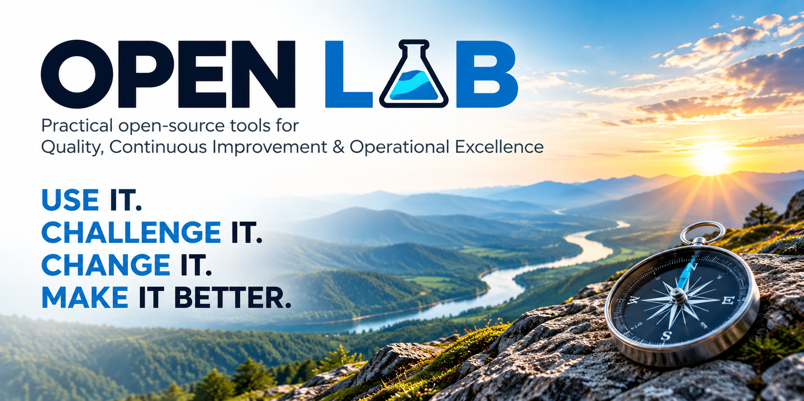

# WhatIfWorks | Open Lab

**Practical open-source artifacts for Quality, Continuous Improvement, and Operational Excellence.**

**Use it. Challenge it. Change it. Make it better.**

Open Lab is a growing collection of practical artifacts, frameworks, diagnostics, worksheets, templates, experiments, and other resources built around real organizational problems.

These are not intended to be shelfware, generic templates, or substitutes for professional judgment.

They're starting points.

Use them.

Challenge them.

Change them.

Make them work in your environment.

And if you learn something useful along the way, consider sharing it back.

---

## Why Open Lab?

Quality, Continuous Improvement, and Operational Excellence practitioners build useful things all the time.

Diagnostics. Worksheets. Decision trees. Assessment tools. Frameworks. Templates. Spreadsheets. Little tools created because somebody needed to solve a real problem.

We're often very disciplined about version control once something becomes part of a formal system.

Our own practitioner resources?

Not always.

They tend to live on hard drives.

They get emailed to someone. Copied. Modified. Carried to another organization. Maybe turned into a PDF.

And occasionally, somewhere along the way, declared a "best practice."

Open Lab takes a different approach:

**Build it. Share it. Fork it. Change it. Test it. Improve it.**

Then, when you've learned something useful, contribute something back so the next practitioner doesn't necessarily have to start from scratch.

---

## The Idea

Open Lab isn't built around the assumption that one person, organization, consultant, or vendor has the right answer.

Different industries, organizations, disciplines, and operating environments produce different constraints and different solutions.

That's useful.

The goal isn't to create one universal answer.

The goal is to make practitioner thinking visible, inspectable, adaptable, and improvable.

That means:

- source should be available whenever practical;
- open formats should be preferred whenever practical;
- assumptions should be visible;
- limitations should be acknowledged;
- alternatives should be allowed to coexist;
- professional judgment still matters;
- disagreement is allowed;
- and nothing becomes "best practice" simply because it appears here.

---

## Open Lab Artifacts

Artifacts will live under `artifacts/`.

Artifacts are organized by primary practitioner domain:

- **Quality Excellence** — `quality-excellence/`
- **Operational Excellence** — `operational-excellence/`
- **Continuous Improvement** — `continuous-improvement/`, including Lean Six Sigma

Collection 001 — Initial Diagnostics is a logical release grouping across these domains. Each diagnostic has one physical home; its use may span several domains.

Each artifact should explain:

- what it is;
- what problem it is intended to help explore or solve;
- who might find it useful;
- how it might be used;
- important assumptions and limitations;
- and what can be changed.

### Planned Initial Collection

Collection 001 — Initial Diagnostics will group the initial experimental diagnostics across the domains above. DOCX is the authoritative working artifact, PDF its distribution format, and Markdown companion guidance. The approved workflow is manual Microsoft Word editing and Word export to PDF.

---

## How to Participate

You do not need to know Git to participate.

You also don't have to contribute anything.

Use the artifacts. Change them for your own environment. Ignore the parts that don't help.

If you do want to participate, there are several ways in.

### Discussions — Explore

Use a Discussion when you want to:

- ask a question;
- compare approaches;
- share practitioner experience;
- challenge an assumption;
- explore an idea that isn't fully formed;
- or see whether other people are encountering the same problem.

A Discussion does not need to end with a change.

Sometimes the conversation itself is useful.

### Issues — Identify

Open an Issue when you've identified something specific.

Maybe:

- something doesn't work;
- something is confusing;
- an assumption doesn't fit your environment;
- information is missing;
- you've found an accessibility problem;
- or you have a concrete idea for a new artifact or improvement.

You don't need to know how to fix it.

Identifying the problem is a contribution.

### Pull Requests — Change

Submit a Pull Request when you've actually made a change you'd like Open Lab to consider.

That might include:

- correcting documentation;
- improving an existing artifact;
- adding an example or variant;
- improving accessibility;
- contributing a new artifact;
- or changing how Open Lab itself works.

If you've never used GitHub this way before, start with:

`How to Contribute`

---

## Open Source First. Open Formats First.

Open Lab artifacts should remain inspectable and editable whenever practical.

Preferred formats may include:

- Markdown (`.md`)
- OpenDocument Text (`.odt`)
- OpenDocument Spreadsheet (`.ods`)
- OpenDocument Presentation (`.odp`)
- CSV
- JSON
- YAML
- SVG
- actual source code

Compatibility formats such as DOCX, XLSX, PPTX, and PDF may also be provided when they make the work easier to use.

The goal isn't format purity.

The goal is to keep useful work open to continued improvement.

See the `Open Lab Artifact Standard` for more detail.

---

## Human Judgment Still Matters

AI-assisted work is welcome here.

So are spreadsheets, scripts, templates, frameworks, software, and whatever useful thing somebody figures out next.

But tools do not replace accountability.

If you contribute something, you should understand it well enough to review it, challenge it, explain your thinking, and stand behind what you submit.

AI is a tool.

It isn't the practitioner.

---

## What Not to Share

Do not contribute material you do not have the right to share.

That includes:

- confidential information;
- proprietary employer material;
- customer-specific information;
- employee-specific information;
- controlled documents;
- copyrighted commercial products;
- credentials, passwords, tokens, or secrets;
- or lightly disguised versions of somebody else's intellectual property.

Bring the lesson.

Bring the principle.

Build something you can legitimately share.

---

## Licensing

Open Lab uses different open licenses for different kinds of work.

Unless otherwise identified:

- practitioner artifacts and documentation are licensed under the **Creative Commons Attribution-ShareAlike 4.0 International License (CC BY-SA 4.0)**;
- software components use an appropriate software license and are intended to use the **MIT License** by default.

Commercial use is permitted under CC BY-SA 4.0 subject to the terms of that license.

See [`LICENSE.md`](LICENSE.md) for the repository's licensing framework and any artifact-specific licensing information.

---

© 2026 Daniel Venn | WhatIfWorks Open-Lab
Licensed under CC BY-SA 4.0

Open Lab covers the public materials in this repository. Separate commercial WhatIfWorks products are outside its scope; Open Lab licensing statements do not apply to those products. Commercial use of Open Lab materials remains permitted under the governing license.

---

## Open Lab Is an Experiment Too

The artifacts aren't the only things open to improvement.

The contribution model, artifact standard, repository structure, documentation, and Open Lab itself can change as we learn what works.

If something here is dumb, say so.

Better yet, help make it less dumb.

---

**Use it. Challenge it. Change it. Make it better. Share what you learned.**